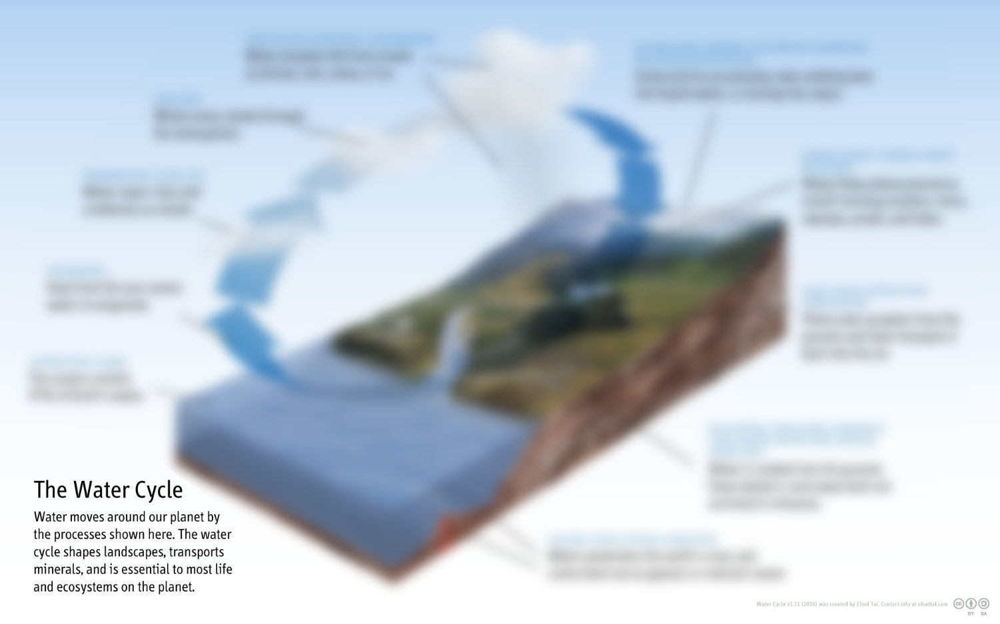

**Researcher in Statistical Hydrology**

 
Modified from <a href="https://commons.wikimedia.org/wiki/File:Diagram_of_the_Water_Cycle.jpg">Ehud Tal</a>

My research revolves around the development of **probabilistic models** to quantify **uncertainties** in hydrologic data and models, and to describe the **space-time variability** of **hydrologic extremes** such as floods and droughts.

The list of scientific papers I contributed to can be found on [ORCID](https://orcid.org/0000-0001-8447-5430).

Development codes and operational software I am contributing to can be found on my [GitHub page](https://github.com/benRenard).

I try to discuss and illustrate my work in a [♫ musical blog ♫](https://globxblog.github.io/)

<iframe src="https://player.vimeo.com/video/481648928" frameborder="0" width="100%" height="440" allowfullscreen="allowfullscreen"></iframe>  

