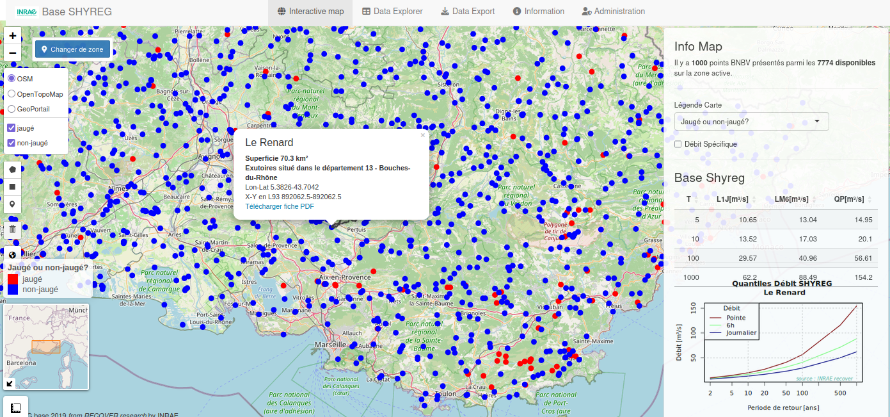

**SHYREG refers both to a method for estimating rainfall and floods with long return periods and to the two databases derived from it: [SHYREG Rainfall](https://shyreg.pluie.recover.inrae.fr/), which provides rainfall quantiles on a regular grid, and [SHYREG Discharge](https://shyreg.recover.inrae.fr/), which provides discharge quantiles at catchment outlets, including ungauged ones.**

The databases give, for example, the 100-year 1-hour rainfall on any square kilometre of mainland France, or the 10-year peak discharge of a small stream with no gauging station. Such values are used in particular for hydraulic structure design, flood hazard mapping and risk studies.

The databases are built from hourly outputs of the SHYPRE generator, regionalized so that they can be projected onto the cells of a regular grid. Rainfall quantiles, for durations ranging from 5 minutes to 72 hours, are computed from these simulated series: this is the content of SHYREG Rainfall. The simulated rainfall is then fed into a rainfall-runoff model, and the resulting discharges are aggregated at the catchment scale: this is the content of SHYREG Discharge.

Both databases are available through web applications built with [Shiny](https://shiny.posit.co/) in collaboration with [Hydris hydrologie](https://www.hydris-hydrologie.fr/), which share the same layout. The **Interactive Map** tab displays a map where clicking on a pixel or an outlet shows its quantiles as a table and an Intensity-Duration-Frequency curve. The **Data Explorer** tab finds pixels or catchments by département, municipality or river name. The **Data Export** tab, whose access depends on user rights, extracts quantiles for a set of points (from a search, a polygon drawn on the map, or an outlet and those located within its catchment) in .csv or excel format.

  
Interactive Map tab of the SHYREG Discharge application.

| | SHYREG Rainfall | SHYREG Discharge |
|---|---|---|
| Support | Pixels of a regular grid (500 m or 1 km depending on the area) | Outlets from the HYDRO, BNBV and CVH databases |
| Variables | Rainfall accumulations from 5 min to 72 h | Peak discharge (QP), 6-hour (LM6) and 1-day (L1J) mean discharge |
| Return periods | 2 to 1000 years | Several return periods |
| Areas covered | Mainland France, La Réunion, French Antilles, New Caledonia | Mainland France, Martinique |
| Uncertainty | 70% confidence interval bounds | — |

In exported files, rainfall columns are named `PM[duration].[period]` (`PM01.0010`: 1-hour maximum rainfall, 10-year return period) and discharge columns `[duration]_[period]` (`QP_2`: 2-year peak discharge; `LM6_10`: 10-year 6-hour mean discharge).

The method is described in detail in the [SHYREG user guide](https://shyreg.recover.inrae.fr/Notice_SHYREG.pdf) (in French).

Contact: [Patrick Arnaud](mailto:patrick.arnaud@inrae.fr)
